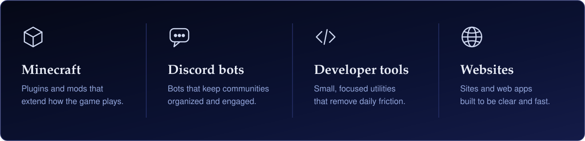
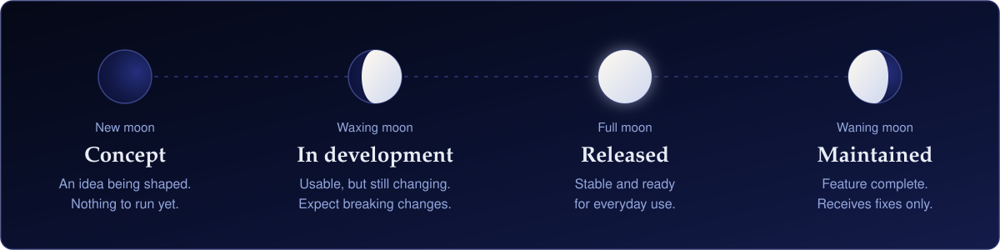
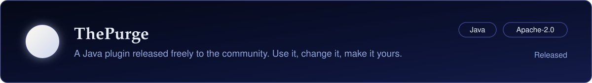
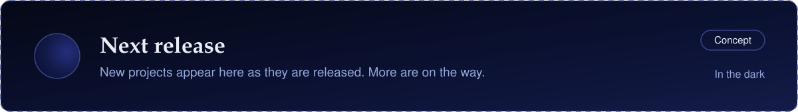
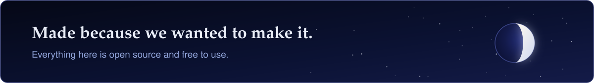

 

FrndlyMoon is an open-source organization. We build software for games, communities and developers, and we publish all of it so anyone can use it, learn from it and improve it.

## What we build

## Project phases

Every project carries a phase, named after the moon, so you can tell at a glance what to expect from it.

## Projects

## Contributing

| Report a problem | Suggest an idea | Send a change |
| :--- | :--- | :--- |
| Open an issue in the affected repository, with the steps needed to reproduce it. | Start with an issue, so we can agree on direction before any code is written. | Fork the repository, create a branch and open a pull request. Keep each change focused. |

Contributions are released under the license of the repository they are made to.

